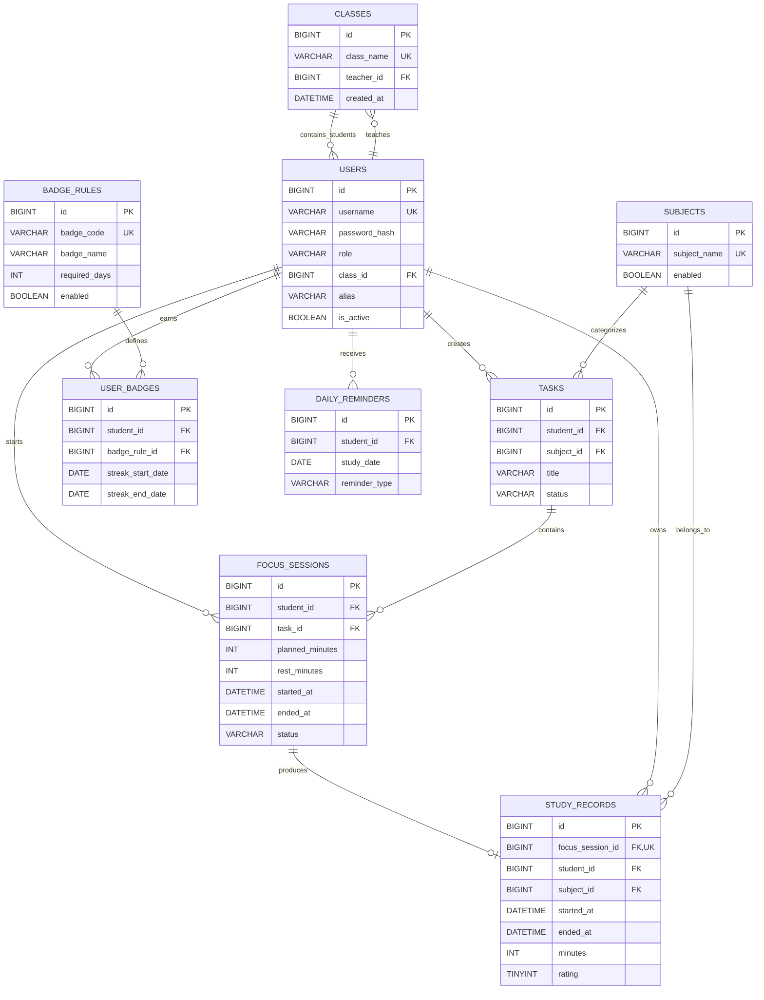

# 学生学习时间管理与效率分析系统
## 数据库 ER 关系图



## 关系说明

- 一个班级有多个学生。
- 一位班主任可以管理多个班级。
- 一个学生可以创建多个学习任务。
- 一个任务可以对应多次专注会话。
- 一次专注会话最多生成一条学习记录。
- 一个学生可以获得多个不同连续周期的勋章。
- 每个学生每天同种提醒只允许记录一次。

## 数据完整性约束

1. 学习记录的 focus_session_id 必须唯一。
2. 学习分钟必须大于0，自评必须为1至5。
3. 勋章按学生、规则和连续学习周期设置联合唯一约束。
4. 每日提醒按学生、日期和提醒类型设置联合唯一约束。
5. 班主任不能通过更改请求参数查看学生个人明细。
6. 初始化数据必须支持重复执行，不产生重复记录。
```
